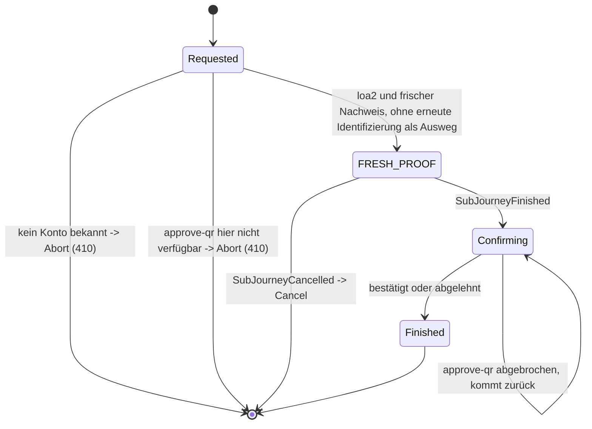

> Eine Journey aus dem Katalog. Wie die Diagramme zu lesen sind, erklärt
> [../04-orchestrierung.md](../04-orchestrierung.md), Abschnitt 3.

# `CONFIRM_PEER_LOGIN`

Mit dieser Journey bestätigt die App eine Anmeldung auf der Website oder lehnt sie ab. Das ist der
QR-Login, also „mit dem Handy anmelden“: Die Website zeigt einen QR-Code, und der Nutzer gibt die
Anmeldung in der App frei.

**Zwei Kanäle, keine Sonderregel.** Ein Kanal ist die Verbindung eines Nutzers zum Orchestrator,
hier einmal die Website (Web-Kanal) und einmal die App. Im Web-Kanal stoßen `auth-qr` oder
`auth-qr-lookup` den Vorgang an. Am Vertrag der Journeys ändert das nichts. Das Ergebnis
(`ToolOutcome`) des App-Tools `approve-qr` wirkt nur auf die **eigene** `AuthJourney`
(`Action.RecordApproval`). Die Verbindung zwischen den beiden Kanälen liegt im Modul `auth_qr`. Dort
gibt es eine gemeinsame `QrLoginRequest`-Zeile, die beide Seiten lesen und schreiben. Deshalb
braucht die SPI der Journeys, also ihre gemeinsame Schnittstelle, keinen Sonderfall für Abläufe
über zwei Kanäle.

**Zwei Wege hinein.** `CONFIRM_PEER_LOGIN` ist **zweierlei**: ein Einstieg für eine neue Journey und
ein zusätzlicher Schritt in einer bereits angemeldeten Sitzung (Orchestrierung, Abschnitt 2). Beide
Wege führen in denselben Zustand `Requested`.

**Keine zusätzliche Rückfrage.** Vor den folgenden Sicherheitsprüfungen gibt es bewusst **keine**
eigene Frage „Möchten Sie bestätigen?“. Fehlt `loa2`, startet ohnehin ein Step-up, der das
Sicherheitsniveau anhebt. Dieser Step-up erklärt selbst, warum gefragt wird, und bietet
„Abbrechen“ als Ausweg an. Den Text dafür liefert der Zweck im Ziel von `StepUpJourney.toward`
(`ProofPurpose.PEER_LOGIN`).

Die Journey läuft in drei Schritten, für einen kalt geöffneten und einen angemeldeten Kanal gleich:

1. **Ohne Konto geht nichts.** Ist über die Geräteverknüpfung (`DeviceAccountLink`) kein Konto
   bekannt, endet die Journey sofort mit `Abort`. Identifizierung und Registrierung werden **nicht**
   angeboten. Dasselbe gilt, wenn `approve-qr` auf diesem Kanal nicht verfügbar ist: Die Journey
   verlangt keinen Nachweis, den sie danach nicht verwenden kann.
2. **`loa2` und ein frischer Nachweis**, als Sub-Journey [`FRESH_PROOF`](fresh-proof.md)
   ([ADR-61](../adr/ADR-061-frischer-nachweis-als-gemeinsame-sub-journey.md)). Die Schwelle ist fest `loa2`, auch für Konten, die nie identifiziert wurden.
   Reicht das Niveau nicht, läuft darin ein Step-up, und anders als bei `MANAGE_AUTH_METHODS` ohne
   Ausweg über eine erneute Identifizierung (`Purpose.PEER_LOGIN`): Wer einen fremden Login
   bestätigt, soll sich dafür keine frische Identität verschaffen können. Reichte das Niveau schon,
   gilt dieselbe Frist wie bei `DELETE_ACCOUNT`: Ist der jüngste Nachweis älter als fünf Minuten,
   weist der Nutzer ein beliebiges aktives Verfahren neu nach. Dieser Nachweis erlaubt nur diese
   eine Bestätigung und wird nie zum Nachweis der Sitzung.
3. Danach wird `approve-qr` gestartet (`Confirming`). Es ist der einzige Kandidat. Geht der Nutzer
   dort zurück (`Abandoned`), lehnt er die Anfrage damit nicht ab. Er kommt nur wieder zum selben
   Kandidaten.
4. `approve-qr` hat nach der Freigabe einen dritten Schritt `showCode`. Die App zeigt dort den
   Bestätigungscode, den der Nutzer in den wartenden Browser tippt. Erst damit ist der Browser
   angemeldet ([Verfahren `qr`](../verfahren/qr.md), Abschnitt „Sicherheit des Pairing-Codes“).
   `done` schließt das Tool ab.
5. Das Ziel ist erreicht, sobald das Tool `Completed` oder `Failed` meldet. Die Kandidatenliste wird
   danach nicht noch einmal angeboten. Die Journey endet mit diesem einen Tool, und der Kanal ist
   `AUTHENTICATED`. War die App vorher nicht angemeldet, fragt sie selbst, ob der Kanal angemeldet
   bleiben soll, und meldet sich sonst per `DELETE /channels/{id}` ab. Diese Frage ist Bedienung,
   kein Zustand der Journey ([ADR-60](../adr/ADR-060-abmeldung-ueber-keycloak-back-channel-logout.md)).

**Der Pairing-Code.** Der Pairing-Code ist die kurze Zeichenfolge, die der Browser neben dem
QR-Code zeigt. Er wird **nicht** beim Anlegen des Kanals übergeben. Er ist ein Eingabefeld im ersten
Schritt von `approve-qr`. Der QR-Code (in der Demo der Link) enthält einen Deep-Link, also einen
Link, der direkt eine bestimmte Stelle in der App öffnet. Er setzt in der App
`intent=confirm_peer_login` und gibt den `pairingCode` mit, sodass das Feld schon ausgefüllt ist
([Frontend](../10-frontend.md)).

Dass der Deep-Link den Pairing-Code vorbelegt, ist unkritisch. Die Freigabe allein meldet keinen
Browser an. Dafür muss der Bestätigungscode erst zurück in den Browser.
