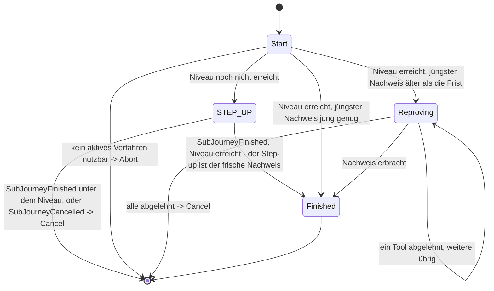

> Eine Journey aus dem Katalog. Wie die Diagramme zu lesen sind, erklärt
> [../04-orchestrierung.md](../04-orchestrierung.md), Abschnitt 3.

# `FRESH_PROOF`

Mit dieser Sub-Journey prüft eine Journey, bevor sie auf das Konto wirkt, zwei Dinge: Die Sitzung hat
das verlangte Sicherheitsniveau, und ihr jüngster Nachweis ist frisch. Nie direkt, nur über
`Transition.RequireSubJourney`; genutzt von [`DELETE_ACCOUNT`](delete-account.md),
[`MANAGE_AUTH_METHODS`](manage-auth-methods.md) und [`CONFIRM_PEER_LOGIN`](confirm-peer-login.md)
([ADR-61](../adr/ADR-061-frischer-nachweis-als-gemeinsame-sub-journey.md)).

**Was der Aufrufer vorgibt.** `FreshProofState.forSubJourney(requiredAcr, purpose)`: das
verlangte Niveau und den Zweck (`Purpose`). Der Zweck
bestimmt die Wortwahl der Auswahlseite und, ob ein Step-up die erneute Identifizierung als Ausweg
anbieten darf. Für `CONFIRM_PEER_LOGIN` darf er das nicht: Wer einen fremden Login bestätigt, soll
sich dafür keine frische Identität verschaffen können. Was der Nachweis danach erlaubt, entscheidet
allein der Aufrufer.

**Niveau zuerst.** Reicht das Niveau nicht, läuft [`STEP_UP`](step-up.md) als Sub-Journey dieser
Sub-Journey. Erreicht er das Niveau, ist er zugleich der frische Nachweis; ein zweiter wird nicht
verlangt. Bleibt er darunter oder lehnt der Nutzer ihn ab, endet `FRESH_PROOF` mit `Cancel`. Ein
schwächerer Nachweis springt nie ein: Sonst käme eine Sitzung, die das Niveau nicht erreicht, mit
genau dem Verfahren durch, das es nicht erreichen konnte.

**Dann die Frische.** Der jüngste Nachweis der Sitzung darf höchstens fünf Minuten alt sein
(`AuthPolicy.hasFreshProof`, `identity.policy.self-service-max-age`). Ist er älter, weist der
Nutzer in `Reproving` noch einmal ein beliebiges aktives Verfahren nach, egal welches Niveau es
erreicht (`CandidateTools.forReconfirmation`). `Reproving` verbucht ihn als `Action.Reconfirm`,
nie als `Action.AcceptProof`: Er wird nie als Nachweis der Sitzung (`MethodEvidence`) gespeichert
und erlaubt genau die eine Aktion des Aufrufers. Danach endet die Sub-Journey.

**Was zurückkommt.** Der Aufrufer erhält `SubJourneyFinished(FRESH_PROOF)` und führt dann aus, was
er wollte; bei `SubJourneyCancelled` endet auch er. Ins Anmeldeprotokoll schreibt `FRESH_PROOF`
nichts, nur ein Step-up darin schreibt seinen eigenen Eintrag.

**Wie lange der Nachweis trägt.** Geprüft wird einmal, wenn `FRESH_PROOF` beginnt, nicht noch
einmal, wenn der Aufrufer handelt. Für einen Aufrufer, der sofort handelt, ist das gleich: `DELETE_ACCOUNT`
löscht, `MANAGE_AUTH_METHODS` entfernt eine Methode oder zieht eine Angabe zurück, im selben
Schritt. Wer danach ein Verfahren anbietet, bei dem der Nutzer selbst weitermacht, lässt ihm Zeit:
eine neue Methode einrichten oder eine ändern (`MANAGE_AUTH_METHODS`), einen fremden Login
bestätigen (`CONFIRM_PEER_LOGIN`). Diese Zeit begrenzt nur die Lebensdauer der Journey (60 Minuten
ab ihrem Start). Die Frische sagt also: Wer die geschützte Aktion beginnt, hat sich vor kurzem
ausgewiesen. Sie sagt nicht, dass das beim Abschluss noch so ist. Ein Nachweis aus `Reproving`
steht nirgends, nur der Übergang zum Aufrufer zeugt von ihm; eine zweite Prüfung beim Abschluss
bräuchte deshalb einen Zeitpunkt im Zustand des Aufrufers.
