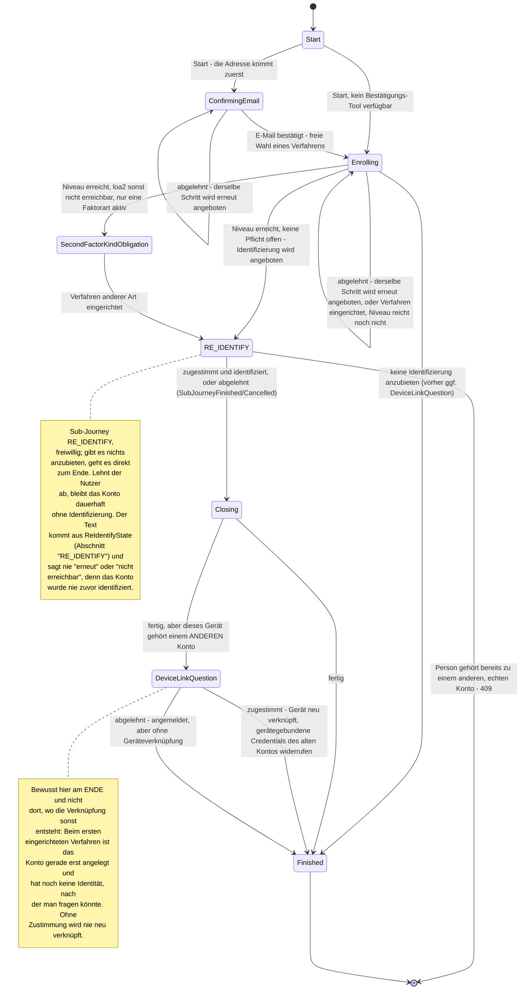

> Eine Journey aus dem Katalog. Wie die Diagramme zu lesen sind, erklärt
> [../04-orchestrierung.md](../04-orchestrierung.md), Abschnitt 3.

# `REGISTER`: Experiment „Erst Anmeldeverfahren einrichten“

Die normale Registrierung beschreibt [`REGISTER`](register.md).

Dies ist eine zweite Variante der Registrierung (`REGISTER`). Sie dreht die
Reihenfolge um: Der Nutzer richtet zuerst Anmeldeverfahren ein, und die Identifizierung wird erst
am Ende angeboten.

**Dieselbe Journey, dieselben Zustände.** Beide Varianten laufen in `RegisterJourney` und nutzen
dieselben Zustände (`RegisterState`, `Enrolling`, `DeviceLinkQuestion`). Die Journey fragt an
wenigen Stellen den Schalter: beim Start (Adresse statt Identifizierung), vor dem Einrichten (keine
loa2-Untergrenze) und am Ende (freiwillige Identifizierung, dann die Gerätefrage).

**Wie die Variante gewählt wird.** Jeder Durchlauf übernimmt beim Start die aktiven Schalter
(`AuthJourney.featureFlags`) und behält sie bis zum Ende. Stellt der Betreiber den Schalter um, gilt
das erst für danach gestartete Registrierungen; eine laufende wechselt nie die Variante.

**Der Schalter.** Eingeschaltet wird die Variante über einen Schalter, den der Betreiber zur
Laufzeit umstellen kann (`JourneyFeatureFlag.REGISTER_ENROLL_FIRST`, `"register-enroll-first"`).
Den Wert liefert `FeatureFlagService` (`@Service`, implementiert `FeatureFlagProvider`) aus der
Tabelle `orchestrator.feature_flag`. Dort steht eine Zeile je Schalter. Fehlt die Zeile, ist der
Schalter aus. Lesen und setzen lässt er sich über
`GET/PUT /orchestrator/admin/registration-order` (`RegistrationOrderController`).

**Grundidee:** Zum Start ist kein Konto nötig. Das Konto entsteht erst, wenn das erste Verfahren
fertig eingerichtet ist, und nicht schon bei der Identifizierung. Das erledigt die allgemeine Aktion
`Action.AdoptCredential` im `JourneyService`. Bis dahin fragt die Journey die
Einrichtungs-Kandidaten ohne Konto ab (`ctx.enrollmentCandidates()` ohne Konto): Dann ist
noch kein Verfahren aktiv.

**Zuerst die E-Mail-Adresse.** Der erste Schritt ist fest: Der Nutzer bestätigt seine
E-Mail-Adresse (`ConfirmingEmail`). Das ist ein `ATTESTATION`-Schritt, der eine Angabe
bestätigt, und kein Einrichten eines Verfahrens. Er lässt sich nicht überspringen; wer ablehnt
(`Abandoned`), bekommt ihn erneut angeboten. Hat der Betreiber das Tool gesperrt, entfällt der
Schritt, und die Journey bleibt nicht stehen.

**Danach freie Wahl.** Ein bestimmtes Verfahren schreibt die Variante nicht vor. Der Nutzer wählt
aus allen Einrichtungs-Tools (`Enrolling`), wie in der normalen Variante. Welche
Verfahren das Konto am Ende hat, regeln die üblichen Pflichten (Orchestrierung, Abschnitt 5), in
dieser Reihenfolge:

- ein weiteres Verfahren, falls das Niveau nicht reicht,
- dann die E-Mail-Bestätigung,
- dann die Pflicht zu einem Verfahren einer zweiten Faktorart.

**Die Identifizierung am Ende.** Erst wenn alle Pflichten erfüllt sind, wird die Identifizierung
**einmal angeboten, aber nie erzwungen**. Das geschieht über die Sub-Journey `RE_IDENTIFY`
(`Transition.RequireSubJourney`), also über den gemeinsam genutzten Ablauf zur Identifizierung.

Lehnt der Nutzer ab oder gibt es nichts anzubieten, endet die Journey trotzdem erfolgreich
(`Transition.Authenticated`). Das Konto ist dann angemeldet, aber nicht identifiziert.

Gehört die identifizierte Person bereits zu einem anderen, echten Konto, lehnt der Executor die
Identifizierung mit `409` ab. Zwei echte Konten werden nämlich nie zusammengeführt. Gibt es für
diese Person dagegen nur ein verwerfbares Konto (etwa aus einem früher abgebrochenen eID-Lauf),
wird es übernommen (ADR-20). Verwerfbar ist ein Konto, das keiner Person zugeordnet ist und in dem
nie ein Anmeldeverfahren eingerichtet wurde.

**Rückfrage zum Gerät am Ende.** Das Smartphone kann schon mit einem anderen Konto verknüpft sein.
Dann fragt diese Variante erst am **Ende** der Journey, nach der freiwilligen Identifizierung, ob
es neu verknüpft werden soll (`DeviceLinkQuestion` mit dem Wortlaut `REBIND`).

Der Grund für diesen späten Zeitpunkt: Die normale Variante identifiziert zuerst und kann direkt
danach fragen. Hier verknüpft die Journey dagegen beim ersten eingerichteten Verfahren. Zu diesem
Zeitpunkt ist das Konto gerade erst entstanden und hat noch keine Identität.

Lehnt der Nutzer ab, endet die Registrierung ohne Geräteverknüpfung. Das Konto bleibt über die
Anmeldung per E-Mail-Adresse voll nutzbar ([09-dpop.md](../09-dpop.md) Abschnitt 3).

