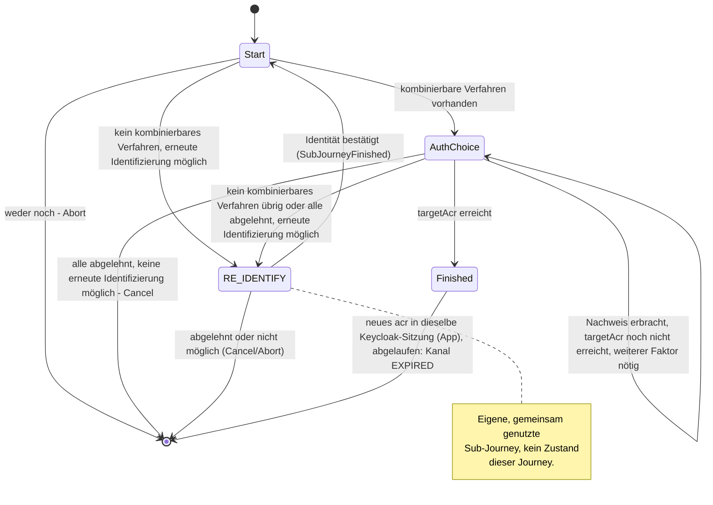

> Eine Journey aus dem Katalog. Wie die Diagramme zu lesen sind, erklärt
> [../04-orchestrierung.md](../04-orchestrierung.md), Abschnitt 3.

# `STEP_UP`

Ein **Step-up** hebt das Sicherheitsniveau (kurz Niveau, `loa1` bis `loa3`) einer schon
angemeldeten Sitzung an. Das ist zum Beispiel vor einer heiklen Aktion nötig. Der Nutzer weist dafür
ein weiteres Anmeldeverfahren nach.

**Was die Zustände enthalten.** Beide Zustände tragen dasselbe Ziel (`StepUpState.Goal`), vom
Start bis zum Ende unverändert. Es hat drei Felder:

- `targetAcr` ist das Niveau, das dieser eine Lauf erreichen soll. Es ist nicht die dauerhafte
  Untergrenze des Kanals (Orchestrierung, Abschnitt 4).
- `startingAcr` ist das Niveau beim Start.
- `purpose` (`ProofPurpose`) nennt die Aktion, für die der Step-up die Hürde ist (über
  `FRESH_PROOF`): `DELETE_ACCOUNT`, `MANAGE_METHODS` oder `PEER_LOGIN`. Daraus folgen der Text und
  ob eine erneute Identifizierung als Ausweg erlaubt ist. Ohne `purpose`, beim einfachen Step-up
  des Kanals, gilt der allgemeine Text, und der Ausweg ist erlaubt.

`AuthChoice` enthält außerdem das Angebot und die bisherigen Ablehnungen. Liegt `startingAcr` über
`NONE`, zählt schon ein Nachweis, und der Text sagt dem Nutzer, dass jetzt ein Verfahren anderer
Art nötig ist.

**Ohne erneute Identifizierung.** `CONFIRM_PEER_LOGIN` fordert seinen Step-up mit dem Zweck
`PEER_LOGIN` an, der keine erneute Identifizierung zulässt. Dann entfällt der Weg über `RE_IDENTIFY` ganz. Reicht kein
Verfahren, endet die Journey mit `Abort` oder `Cancel`.

**Mit erneuter Identifizierung.** Manchmal kann kein aktives Verfahren das fehlende Niveau
liefern. Das betrifft etwa ein Konto mit nur einem aktiven Verfahren, das allein `loa1` erreicht.
Dann bietet die Journey die erneute Identifizierung nicht selbst an. Sie startet stattdessen die
gemeinsam genutzte Sub-Journey [`RE_IDENTIFY`](re-identify.md), also einen untergeordneten Ablauf,
den mehrere Journeys nutzen. Ist die Sub-Journey fertig (`SubJourneyFinished`), prüft `Start` mit
`settle` erneut, ob der Nachweis jetzt reicht.
